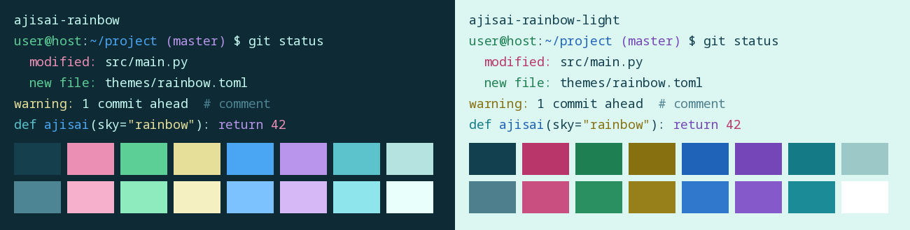
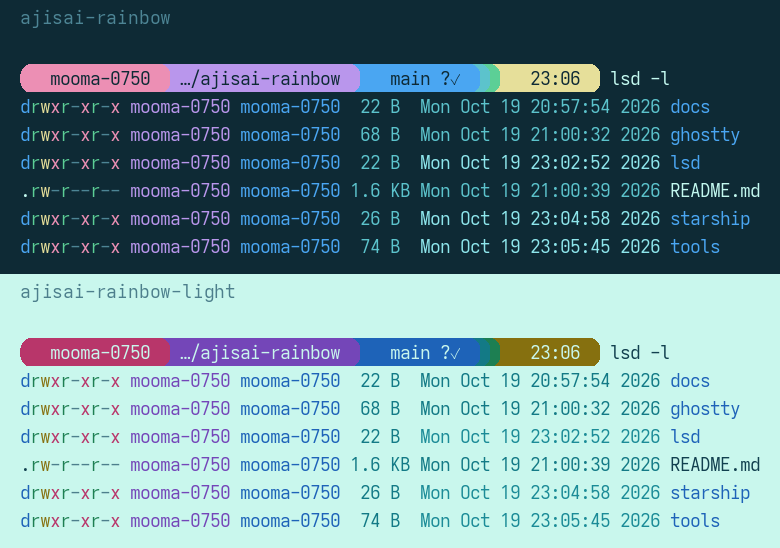

# Ajisai Rainbow

雨上がりの紫陽花、海、空にかかる虹を描いたドット絵から色を取った、ターミナル用のカラーテーマ。Ghostty のテーマと、それに合わせた Starship・lsd の設定がある。

色の出典: 1041uuu さんのドット絵（<https://www.tumblr.com/1041uuu/122075241013>）。このリポジトリは色を参考にしただけで、絵そのものは含まない。



| テーマ | 背景 | 文字 | 用途 |
|---|---|---|---|
| `ajisai-rainbow` | `#0e2a35`（地面の深い青緑） | `#c3f9f0`（雲のミント） | 暗い版 |
| `ajisai-rainbow-light` | `#c9f7ed`（昼の空と雲） | `#12404f`（紺） | 明るい版 |

ANSI の色の割り当て: 緑は紫陽花の葉、青は青い紫陽花、マゼンタは紫の紫陽花、シアンは空。絵はほぼ寒色だけでできていて（虹も藤色・ミント・空色の3本）、赤と黄に当たる色がない。そこで、エラーや警告を見分けられるように、赤はピンク、黄はクリーム色を足した。

## Ghostty で使う

```sh
mkdir -p ~/.config/ghostty/themes
ln -sf "$PWD"/ghostty/ajisai-rainbow* ~/.config/ghostty/themes/
```

`~/.config/ghostty/config.ghostty` に次の1行を足すと、OS の明暗設定に合わせて切り替わる。

```
theme = light:ajisai-rainbow-light,dark:ajisai-rainbow
```

## VS Code で使う

`vscode/` に VS Code の拡張機能がある。暗い版「Ajisai Rainbow」と明るい版「Ajisai Rainbow Light」が入っていて、Windows・macOS・Linux のデスクトップ版と、ブラウザ版（vscode.dev・github.dev）で使える。

- 予約語は紫の紫陽花、文字列は葉の緑、関数は青い紫陽花、型は空の色。誤りはピンク、数と定数はクリーム色
- 括弧の色分けは絵の虹の3本（藤色・ミント・空色）
- 統合ターミナルの16色は Ghostty のテーマと同じ

手元で拡張機能のファイル（.vsix）を作って入れるには:

```sh
cd vscode
npx @vscode/vsce package
code --install-extension ajisai-rainbow-*.vsix
```

色は `tools/vscode_theme.py` が Ghostty のテーマから作る。Ghostty の色を直したら `python3 tools/vscode_theme.py` で作り直す。

## Starship・lsd で使う

どちらも色を 16 色の番号で書いてあり、端末のテーマから色を取る。Ghostty が明暗を切り替えると、プロンプトと `lsd` の色も一緒に変わる。



```sh
ln -sf "$PWD"/starship/starship.toml ~/.config/starship.toml
mkdir -p ~/.config/lsd && ln -sf "$PWD"/lsd/colors.yaml ~/.config/lsd/colors.yaml
```

- Starship: 帯は紫 → 青 → 空色 → 葉の緑の順（紫と青の紫陽花、空、葉）。絵にないピンクと黄は帯に使わず、エラー時の `❯` だけをピンクにする。帯の文字は反転（`inverted`）で端末の背景色になり、暗い版・明るい版のどちらでも対比 4.3 以上。記号に Nerd Font を使う
- lsd も絵にある紫・青・空色・緑を中心にし、ピンクと黄は git の削除・衝突・変更の印だけに使う
- lsd: `~/.config/lsd/config.yaml` に `color: { theme: custom }` を書くと `colors.yaml` が読まれる。ファイル名の色は `LS_COLORS` から取るので、この設定では変わらない

## 色を直したとき

```sh
python3 tools/contrast.py                      # 背景との対比（WCAG のコントラスト比）を表示
python3 tools/preview.py <等幅フォントのパス> docs/preview.png   # 色見本を描き直す（Pillow が要る）
python3 tools/preview_shell.py <等幅フォントのパス> <ANSI のテキスト> docs/shell.png   # Starship と lsd の見本を描き直す
```

暗い版は文字 12.9、明るい版は 9.6 の対比がある。元の絵は他人の作品の可能性があるため、このリポジトリには入れていない。
