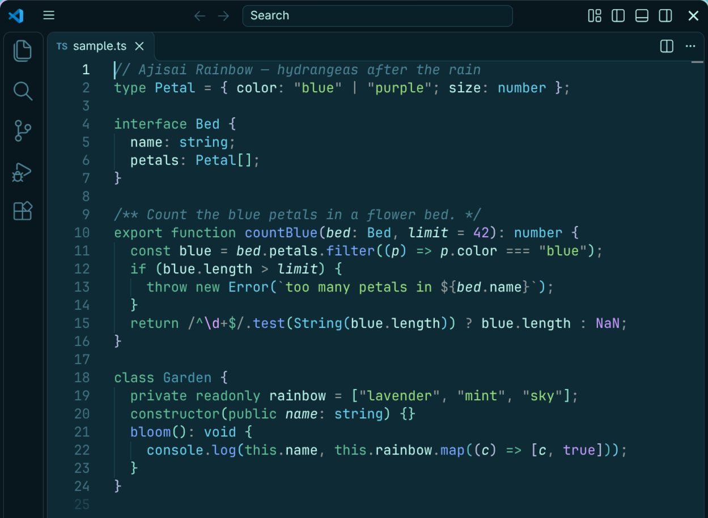
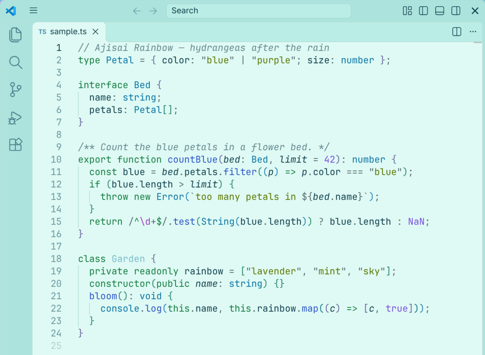

# Ajisai Rainbow

A color theme taken from a pixel-art scene of hydrangeas after the rain, the sea, and a rainbow across the sky. Comes in a dark and a light variant.





| Theme | Background | Text |
|---|---|---|
| Ajisai Rainbow | `#0e2a35` deep teal of the ground | `#c3f9f0` mint of the clouds |
| Ajisai Rainbow Light | `#c9f7ed` daytime sky and clouds (editor `#dffaf4`) | `#12404f` navy |

## How the colors were chosen

The picture is mostly pale mint sky and clouds (58%), leaves in deep and vivid greens (16%), the sea (7%), and hydrangeas as an accent — blue (4.5%) and purple (1.4%). There is no red or yellow at all.

The syntax colors follow the same proportions: the more often a kind of token appears in code, the more common its color is in the picture.

- **Keywords** — deep green of the leaves
- **Strings** — vivid green of the leaves
- **Functions** — blue hydrangeas
- **Types** — the sea
- **Numbers and constants** — purple hydrangeas, used only as an accent
- **Variables and properties** — the text color; parameters in italics
- **Punctuation** — a muted gray that stays out of the way
- **Bracket pairs** — the three bands of the rainbow: lavender, mint and sky blue
- Red and yellow appear only for errors and warnings.

The integrated terminal uses the same 16 colors as the Ghostty theme in the same repository. All colors were tuned by measuring them on an actual VS Code screen, so the frequent ones stay easy to tell apart.

## Usage

Install **Ajisai Rainbow** from the Extensions view, then pick it with **Preferences: Color Theme**. Works in VS Code on Windows, macOS and Linux, in the browser (vscode.dev, github.dev), and in editors that use Open VSX (VSCodium, Cursor, and others).

To follow your OS light/dark setting, add this to your settings:

```json
"window.autoDetectColorScheme": true,
"workbench.preferredDarkColorTheme": "Ajisai Rainbow",
"workbench.preferredLightColorTheme": "Ajisai Rainbow Light"
```

## Credits

Colors are based on a pixel-art piece by 1041uuu (<https://www.tumblr.com/1041uuu/122075241013>). This theme only borrows the colors; the artwork itself is not included.

Source, plus matching themes for Ghostty, Starship and lsd: <https://github.com/MoomA-0750/ajisai-rainbow>
